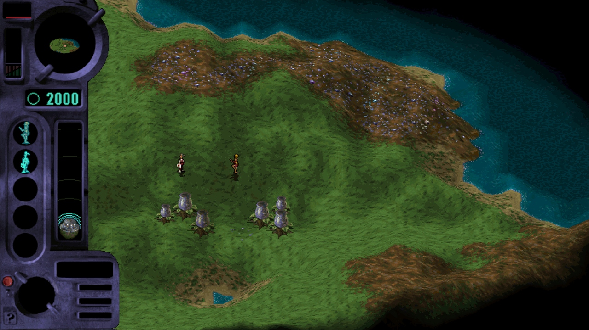
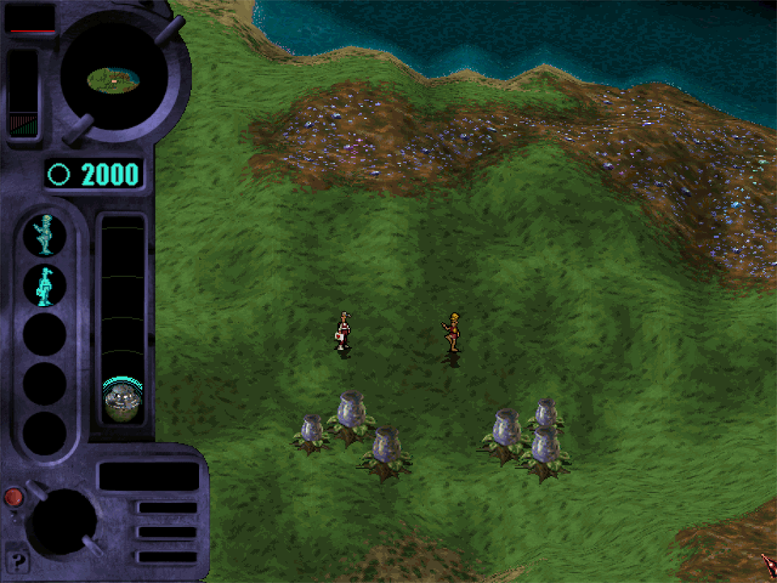
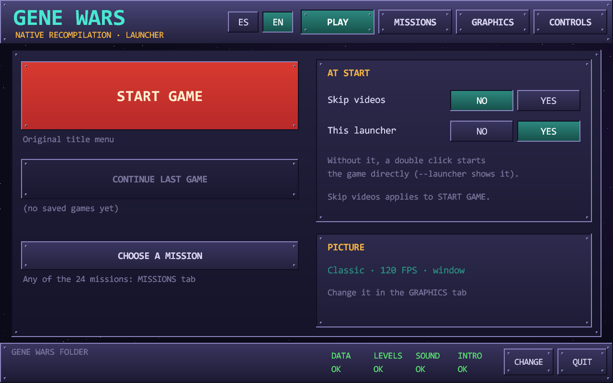
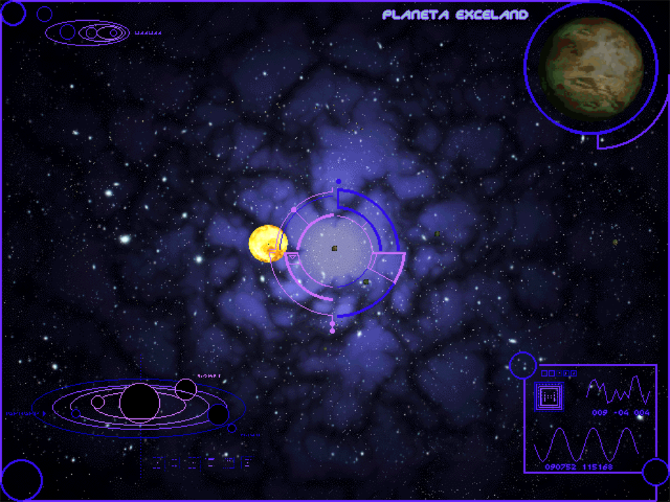

# GWRecomp — Gene Wars, natively on Windows

  
   <em>Mission 1 (Exceland) in widescreen 854×480: an extractor on the GOOP field, the next one being placed, animated sea</em>

**GWRecomp** runs *Gene Wars* (Bullfrog Productions, 1996, version 1.1) as a native Win32 program, without DOSBox.
The original x86-32 DOS4GW executable is statically lifted to C and runs on a modern host layer (SDL2 video, audio
and input, DOS/DPMI services, a virtual Sound Blaster for the game's own Miles mixer, CD-DA playback). The game logic,
AI and mixer are the original code; the host only replaces the hardware and DOS around it.

It needs **your own copy of Gene Wars 1.1**: no game files are included (see [Legal](#legal)).

**Download:** [latest release](https://github.com/Polocop/genewars/releases/latest) (`GWRecomp-*-win32.zip`, Windows,
ready to play with your own `GENEWARS` folder) · **Descarga:** [última versión](https://github.com/Polocop/genewars/releases/latest).

## Screenshots

<table>
  <tr>
    <td width="50%"></td>
    <td width="50%"></td>
  </tr>
  <tr>
    <td align="center"><em>Zoom Out: the 1152×640 map canvas at 0.87×, sharp scaling</em></td>
    <td align="center"><em>Classic 640×480, as in 1996</em></td>
  </tr>
  <tr>
    <td width="50%"></td>
    <td width="50%"></td>
  </tr>
  <tr>
    <td align="center"><em>Native launcher (English / Spanish): start, continue, start-up options</em></td>
    <td align="center"><em>Missions: pick any of the 24 missions</em></td>
  </tr>
  <tr>
    <td width="50%"></td>
    <td width="50%"></td>
  </tr>
  <tr>
    <td align="center"><em>Graphics: view mode, resolution, 60/120 FPS, filter, water and GOOP</em></td>
    <td align="center"><em>The original planet-system screen, with its sounds</em></td>
  </tr>
</table>

The source lives in [`gwrecomp/`](gwrecomp/README.md). This repository started as a fork of
[mefistotelis/genewars](https://github.com/mefistotelis/genewars) and is now a standalone project; that unfinished
engine re-implementation, with its history, stays in the source folders of this repository, untouched. Earlier
GitHub issues are kept in [gwrecomp/docs/issues-archive.md](gwrecomp/docs/issues-archive.md).

## Features

- **Native Win32/SDL2 build** of the original executable: one `gwrecomp.exe` plus `SDL2.dll`, no DOSBox, no emulator.
- **Deterministic regression check:** the A/B suite renders 56 frame captures at four points of mission 1 (after
  the landing, before a creature is ready, during construction, extractor selected) and compares them with reference
  hashes; v1.1 matches all 56 bit for bit. The presentation extras (interpolation, water, audio) never write game
  memory, so they cannot change these frames.
- **Three view modes:**
  - Classic `640×480` (the original frame),
  - Widescreen `854×480`,
  - Zoom Out on a `1152×640` map canvas (wheel zoom 0.87×–2×, Home returns to 1×).
- **Sharp scaling to any window or monitor:** supersampled sharp-bilinear (pixel interiors stay solid, only the seams
  blend), exact nearest when the window is a whole multiple; F7 switches sharp / EPX / CRT.
- **120 FPS presentation** with camera scroll interpolation; the simulation keeps the game's own tick rate.
- **Animated water and GOOP:** sea ripples and drifting glints, soft highlights on GOOP, on ground pixels only and in
  the presented frame only (units, buildings and HUD are never touched).
- **Complete audio:**
  - Smacker video sound,
  - the original Miles sound effects through a virtual SB16,
  - automatic CD-DA music from your own `.cue` image,
  - stereo panning and distance fade calibrated to the visible map width,
  - subtle ±4.5 % pitch variation on effects (never on voices),
  - music ducking while a voice speaks.
- **Native graphical launcher in English and Spanish** (ES / EN buttons; by default it follows the Windows
  language): mission selector 1–24, Continue, view/resolution/filter/audio options, all saved in `gwrecomp.ini`.

## Installation (English)

1. Have **Gene Wars 1.1 (European edition)** installed: the `GENEWARS` folder created by the original installer
   (`DATA`, `LEVELS`, `SOUND`, `INTRO`, `ANIMS`, `LDATA`, `S`, `SPEECH`, `SAVE` and the loose files such as `GW.EXE`).
   GWRecomp checks them with SHA-256 and only reads them.
2. Download `GWRecomp-v1.1-win32.zip` from [Releases](https://github.com/Polocop/genewars/releases/latest) and unzip it anywhere you can write (saves and logs go next to the program).
3. Double-click `gwrecomp.exe`. In the launcher press **CHANGE** and choose your `GENEWARS` folder; the four marks
   DATA / LEVELS / SOUND / INTRO turn green. The **ES / EN** buttons at the top switch the launcher's language.
4. Start the game, continue the last game, or pick a mission.

**First start:** the first time you enter the game, `gwrecomp.exe` prepares two files in `work\` from *your* `GW.EXE`
(checked by SHA-256). It takes a moment and happens once. Those files come from your copy of the game: do not share
them.

**`gwrecomp.ini`** (the launcher writes it; `gwrecomp.ini.example` documents every key):

| Key | Meaning |
|---|---|
| `mode` | `classic`, `widescreen` or `zoomout` |
| `resolution`, `fullscreen` | window size (`auto`, `1080p`, `1440p`, `2160p`, `WxH`), borderless fullscreen |
| `fps` | presentation rate, `60` or `120` |
| `filter` | `sharp`, `epx` or `crt` (also F7 in game) |
| `water_effects` | animated water and GOOP (`1`/`0`) |
| `enhanced_audio` | calibrated panning, pitch variation, music ducking (`1`/`0`) |
| `language` | launcher language: `en`, `es` or `auto` (Windows display language) |
| `cd_cue` | path to your own Gene Wars CD image `.cue`, for the CD music |
| `data_dir` | your `GENEWARS` folder (the launcher fills it in) |

In game: F7 filter, F8 turbo 1×/2×/4×, mouse wheel zoom, Home zoom 1×, F10 release the mouse, WASD / arrows / middle
button scroll the map, ESC game options.

Building from source (Windows, MSYS2 mingw32, Python, LLVM clang) is described in
[gwrecomp/README.md](gwrecomp/README.md) and [gwrecomp/tools/rebuild/README_BUILD.md](gwrecomp/tools/rebuild/README_BUILD.md).

## Instalación (español)

1. Ten instalado **Gene Wars 1.1 (edición europea)**: la carpeta `GENEWARS` que crea el instalador original
   (`DATA`, `LEVELS`, `SOUND`, `INTRO`, `ANIMS`, `LDATA`, `S`, `SPEECH`, `SAVE` y los archivos sueltos como `GW.EXE`).
   GWRecomp los comprueba con SHA-256 y solo los lee.
2. Descarga `GWRecomp-v1.1-win32.zip` de [Releases](https://github.com/Polocop/genewars/releases/latest) y descomprímelo en una carpeta donde puedas escribir (ahí se guardan partidas y registros).
3. Haz doble clic en `gwrecomp.exe`. En el lanzador pulsa **CAMBIAR** y elige tu carpeta `GENEWARS`; las cuatro
   marcas DATA / LEVELS / SOUND / INTRO se ponen en verde. Los botones **ES / EN** de arriba cambian el idioma del
   lanzador.
4. Inicia el juego, continúa la última partida o elige una misión.

**Primer arranque:** la primera vez que entras al juego, `gwrecomp.exe` prepara dos archivos en `work\` a partir de
*tu* `GW.EXE` (comprobado por SHA-256). Tarda un momento y solo ocurre una vez. Salen de tu copia del juego: no los
compartas.

**Opciones:** todo lo que cambias en el lanzador se guarda en `gwrecomp.ini` (modo de vista, resolución, pantalla
completa, 60/120 FPS, filtro, `water_effects`, `enhanced_audio`, `language` = `es` / `en` / `auto`). Para la música del CD añade
`cd_cue = C:\ruta\a\tu\imagen\genewars.cue` con tu propia imagen del CD. `gwrecomp.ini.example` explica cada clave.

## Legal

*Gene Wars* is © Bullfrog Productions / Electronic Arts. GWRecomp is unaffiliated with and unendorsed by the rights
holders.

- **This repository** contains no game executable, data, video, audio, disc image or extracted game code. It contains
  the host layer, the lifter and the tools that translate *your* `GW.EXE` at build time, plus a few screenshots in
  `gwrecomp/docs/screenshots/` that show the game's graphics for illustration only.
- **A built `gwrecomp.exe`** is that translation compiled: it contains native code derived from the original Gene
  Wars program. It contains none of the game's data (graphics, sounds, videos, levels, speech), which are always read
  from your own `GENEWARS` folder. Whether a prebuilt binary may be redistributed is a question for the rights
  holders; this project does not grant any such right.
- No license has been applied to GWRecomp's own code yet (see [gwrecomp/PROVENANCE.md](gwrecomp/PROVENANCE.md));
  default copyright applies. Third-party components keep their licenses ([THIRD_PARTY_NOTICES](gwrecomp/THIRD_PARTY_NOTICES.md);
  SDL2: zlib).
