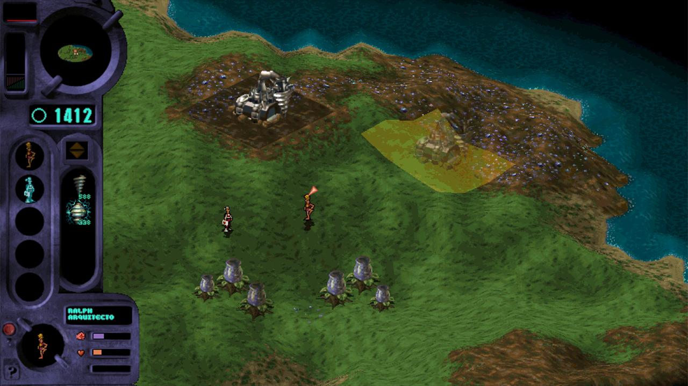
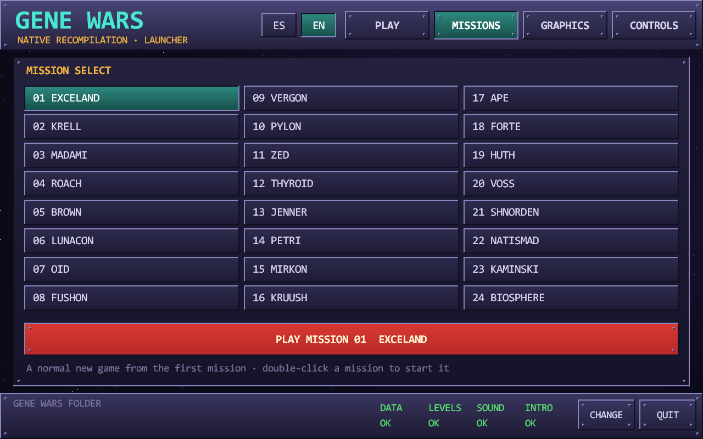
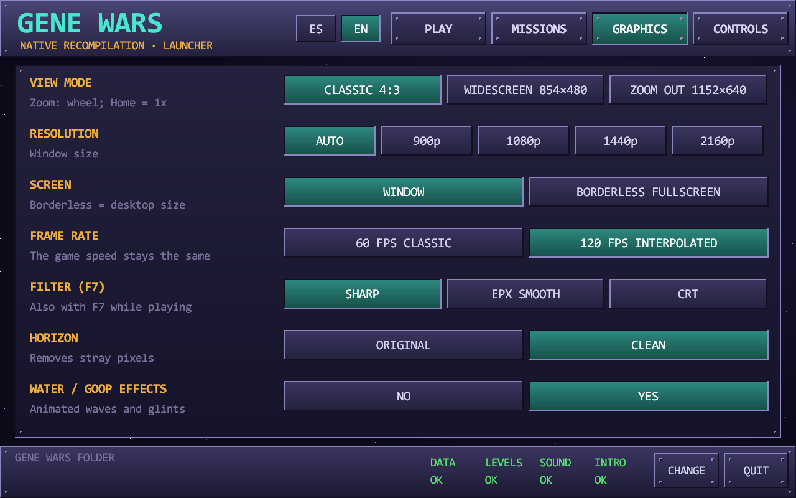

# GWRecomp — Gene Wars, natively on Windows

  
   <em>Mission 1 (Exceland) in widescreen 854×480: an extractor on the GOOP field, the next one being placed, animated sea</em>

**GWRecomp** runs *Gene Wars* (Bullfrog Productions, 1996, version 1.1) as a native Win32 program, without DOSBox.
The original x86-32 DOS4GW executable is statically lifted to C and runs on a modern host layer (SDL2 video, audio
and input, DOS/DPMI services, a virtual Sound Blaster for the game's own Miles mixer, CD-DA playback). The game logic,
AI and mixer are the original code; the host only replaces the hardware and DOS around it.

It needs **your own copy of Gene Wars 1.1**: no game files are included (see [Legal](#legal)).

**Download:** [latest release](https://github.com/Polocop/genewars/releases/latest) (`GWRecomp-*-win32.zip`, Windows,
ready to play with your own `GENEWARS` folder) · **Descarga:** [última versión](https://github.com/Polocop/genewars/releases/latest).

## Screenshots

<table>
  <tr>
    <td width="50%"></td>
    <td width="50%"></td>
  </tr>
  <tr>
    <td align="center"><em>Zoom Out: the 1152×640 map canvas at 0.87×, sharp scaling</em></td>
    <td align="center"><em>Classic 640×480, as in 1996</em></td>
  </tr>
  <tr>
    <td width="50%"></td>
    <td width="50%"></td>
  </tr>
  <tr>
    <td align="center"><em>Native launcher (English / Spanish): start, continue, start-up options</em></td>
    <td align="center"><em>Missions: pick any of the 24 missions</em></td>
  </tr>
  <tr>
    <td width="50%"></td>
    <td width="50%"></td>
  </tr>
  <tr>
    <td align="center"><em>Graphics: view mode, resolution, 60/120 FPS, filter, water and GOOP</em></td>
    <td align="center"><em>The original planet-system screen, with its sounds</em></td>
  </tr>
</table>

The source lives in [`gwrecomp/`](gwrecomp/README.md). This repository started as a fork of
[mefistotelis/genewars](https://github.com/mefistotelis/genewars) and is now a standalone project; that unfinished
engine re-implementation, with its history, stays in the source folders of this repository, untouched. Earlier
GitHub issues are kept in [gwrecomp/docs/issues-archive.md](gwrecomp/docs/issues-archive.md).

## Features

- **Native Win32/SDL2 build** of the original executable: one `gwrecomp.exe` plus `SDL2.dll`, no DOSBox, no emulator.
- **Deterministic regression check:** the A/B suite renders 56 frame captures at four points of mission 1 (after
  the landing, before a creature is ready, during construction, extractor selected) and compares them with reference
  hashes; v1.2 matches all 56 bit for bit. The presentation extras (interpolation, water, audio) never write game
  memory, so they cannot change these frames.
- **Three view modes:**
  - Classic `640×480` (the original frame),
  - Widescreen `854×480`,
  - Zoom Out on a `1152×640` map canvas (wheel zoom 0.87×–2×, Home returns to 1×).
- **Sharp scaling to any window or monitor:** supersampled sharp-bilinear (pixel interiors stay solid, only the seams
  blend), exact nearest when the window is a whole multiple; F7 switches sharp / EPX / CRT.
- **120 FPS presentation** with camera scroll interpolation; the simulation keeps the game's own tick rate.
- **Animated water and GOOP:** sea ripples and drifting glints, soft highlights on GOOP, on ground pixels only and in
  the presented frame only (units, buildings and HUD are never touched).
- **Emissive bloom:** a soft GPU glow (Dual Kawase, OpenGL) on energy beams, explosions, Gene Pod lights and GOOP
  glints, in missions only; the left HUD and plain terrain never glow, and the game's own frames are unchanged. On/off
  in the launcher's GRAPHICS tab; strength `bloom_intensity` in `gwrecomp.ini`.
- **Terrain ambient occlusion and soft shadows:** crater floors, valleys, creases and the foot of hills darken from
  the real terrain heights, captured while the game rasterizes its terrain mesh (GPU, OpenGL; strength
  `terrain_ao_strength`, 0.40), and the game's hard shadows of ships, flyers and buildings are redrawn from the
  clean terrain with soft edges (exactly the pixels the game's shadow routine wrote and no sprite covered; same
  shape and place, no black dither). Missions only, presented frame only;
  sprites, water, GOOP and the HUD are never darkened. On/off in the GRAPHICS tab.
- **4K particles:** atmosphere by planet type, drawn by the GPU at the window's own resolution on every presented
  frame and anchored to the scenery (they follow the interpolated camera and the zoom): luminous spores and a thin
  sea mist on green planets, mineral dust and sand gusts on arid ones, ash and faint embers on dark ones, snow on
  icy ones; energy sparks and landing dust around the Ethereal ship and along its teleport beam (positions taken
  from the pixels the game draws). Missions only, never over the HUD; `particle_density` 0.0–2.0. On/off in the
  GRAPHICS tab.
- **Complete audio:**
  - Smacker video sound,
  - the original Miles sound effects through a virtual SB16,
  - automatic CD-DA music from your own `.cue` image,
  - stereo panning and distance fade calibrated to the visible map width,
  - subtle ±4.5 % pitch variation on effects (never on voices),
  - music ducking while a voice speaks.
- **Native graphical launcher in English and Spanish** (ES / EN buttons; by default it follows the Windows
  language): mission selector 1–24, Continue, view/resolution/filter/audio options, all saved in `gwrecomp.ini`.

## Installation (English)

> **Version check.** GWRecomp is built on the `GW.EXE` of the official **1.1 patch** (built 26 Nov 1996). The European
> CD itself, and the common "Genewars (Europe) (En,Fr,De,Es,It,Sv)" image, carry the original 1.0 `GW.EXE` (built
> 2 Sep 1996, 1,265,994 bytes), which GWRecomp refuses ("GW.EXE is not the Gene Wars 1.1 one..."): install the game
> from the CD and apply the 1.1 patch first. Installs in **English, French, German, Italian, Spanish or Swedish** are
> accepted (speech files of the six languages are known). Only the Spanish 1.1 `TEXT.DAT` has been seen so far; the
> other languages' 1.1 `TEXT.DAT` is accepted when it has the 1.1 layout (627 texts), and that case has not been tested
> with a real installation yet.

1. Have **Gene Wars 1.1 (European edition)** installed: the `GENEWARS` folder created by the original installer
   (`DATA`, `LEVELS`, `SOUND`, `INTRO`, `ANIMS`, `LDATA`, `S`, `SPEECH`, `SAVE` and the loose files such as `GW.EXE`).
   GWRecomp checks them with SHA-256 and only reads them.
2. Download `GWRecomp-v1.2-win32.zip` from [Releases](https://github.com/Polocop/genewars/releases/latest) and unzip it anywhere you can write (saves and logs go next to the program).
3. Double-click `gwrecomp.exe`. In the launcher press **CHANGE** and choose your `GENEWARS` folder; the four marks
   DATA / LEVELS / SOUND / INTRO turn green. The **ES / EN** buttons at the top switch the launcher's language.
4. Start the game, continue the last game, or pick a mission.

**"Windows protected your PC":** `gwrecomp.exe` is not code-signed, so Windows SmartScreen may stop it the first
time. Click **More info → Run anyway**. If Windows blocks the downloaded zip as a whole, right-click it before
unzipping → **Properties** → tick **Unblock** → **OK**. You can check the file against the SHA-256 published with
each release.

**First start:** the first time you enter the game, `gwrecomp.exe` prepares two files in `work\` from *your* `GW.EXE`
(checked by SHA-256). It takes a moment and happens once. Those files come from your copy of the game: do not share
them.

**`gwrecomp.ini`** (the launcher writes it; `gwrecomp.ini.example` documents every key):

| Key | Meaning |
|---|---|
| `mode` | `classic`, `widescreen` or `zoomout` |
| `resolution`, `fullscreen` | window size (`auto`, `1080p`, `1440p`, `2160p`, `WxH`), borderless fullscreen |
| `fps` | presentation rate, `60` or `120` |
| `filter` | `sharp`, `epx` or `crt` (also F7 in game) |
| `water_effects` | animated water and GOOP (`1`/`0`) |
| `emissive_bloom`, `bloom_intensity` | glow on energy, explosions and GOOP (`1`/`0`); strength `0.0`–`1.5` (default `0.65`) |
| `terrain_ao`, `terrain_ao_strength` | terrain ambient occlusion from the real heights, GPU (`1`/`0`); strength `0.0`–`1.0` (default `0.40`) |
| `soft_shadows` | the game's shadows with soft edges (`1`/`0`) |
| `hd2d_particles`, `particle_density` | GPU particles by planet type and around the Ethereal ship (`1`/`0`); amount `0.0`–`2.0` (default `1.0`) |
| `enhanced_audio` | calibrated panning, pitch variation, music ducking (`1`/`0`) |
| `language` | launcher language: `en`, `es` or `auto` (Windows display language) |
| `cd_cue` | path to your own Gene Wars CD image `.cue`, for the CD music (launcher: PLAY → **CD IMAGE**) |
| `data_dir` | your `GENEWARS` folder (the launcher fills it in) |

In game: F7 filter, F8 turbo 1×/2×/4×, mouse wheel zoom, Home zoom 1×, F10 release the mouse, WASD / arrows / middle
button scroll the map, ESC game options.

Building from source (Windows, MSYS2 mingw32, Python, LLVM clang) is described in
[gwrecomp/README.md](gwrecomp/README.md) and [gwrecomp/tools/rebuild/README_BUILD.md](gwrecomp/tools/rebuild/README_BUILD.md).

## Instalación (español)

> **Comprueba la versión.** GWRecomp está hecho sobre el `GW.EXE` del **parche oficial 1.1** (compilado el 26/11/1996).
> El CD europeo, y la imagen habitual «Genewars (Europe) (En,Fr,De,Es,It,Sv)», traen el `GW.EXE` original 1.0
> (02/09/1996, 1.265.994 bytes), que GWRecomp rechaza («GW.EXE no es el de Gene Wars 1.1…»): instala el juego desde el
> CD y aplica antes el parche 1.1. Se aceptan instalaciones en **inglés, francés, alemán, italiano, español o sueco**.
> Del `TEXT.DAT` 1.1 solo se conoce el español; el de los demás idiomas se acepta si tiene el formato 1.1 (627
> textos), y ese caso aún no se ha probado con una instalación real.

1. Ten instalado **Gene Wars 1.1 (edición europea)**: la carpeta `GENEWARS` que crea el instalador original
   (`DATA`, `LEVELS`, `SOUND`, `INTRO`, `ANIMS`, `LDATA`, `S`, `SPEECH`, `SAVE` y los archivos sueltos como `GW.EXE`).
   GWRecomp los comprueba con SHA-256 y solo los lee.
2. Descarga `GWRecomp-v1.2-win32.zip` de [Releases](https://github.com/Polocop/genewars/releases/latest) y descomprímelo en una carpeta donde puedas escribir (ahí se guardan partidas y registros).
3. Haz doble clic en `gwrecomp.exe`. En el lanzador pulsa **CAMBIAR** y elige tu carpeta `GENEWARS`; las cuatro
   marcas DATA / LEVELS / SOUND / INTRO se ponen en verde. Los botones **ES / EN** de arriba cambian el idioma del
   lanzador.
4. Inicia el juego, continúa la última partida o elige una misión.

**«Windows protegió su PC»:** `gwrecomp.exe` no está firmado digitalmente, así que SmartScreen puede detenerlo la
primera vez. Pulsa **Más información → Ejecutar de todas formas**. Si Windows bloquea el zip descargado, antes de
descomprimirlo haz clic derecho → **Propiedades** → marca **Desbloquear** → **Aceptar**. Puedes comprobar el archivo
con el SHA-256 que se publica en cada versión.

**Primer arranque:** la primera vez que entras al juego, `gwrecomp.exe` prepara dos archivos en `work\` a partir de
*tu* `GW.EXE` (comprobado por SHA-256). Tarda un momento y solo ocurre una vez. Salen de tu copia del juego: no los
compartas.

**Opciones:** todo lo que cambias en el lanzador se guarda en `gwrecomp.ini` (modo de vista, resolución, pantalla
completa, 60/120 FPS, filtro, `water_effects`, `emissive_bloom` (bloom emisivo; intensidad con `bloom_intensity`), `terrain_ao` (oclusión del terreno en GPU; `terrain_ao_strength`), `soft_shadows` (sombras suaves), `hd2d_particles` (partículas 4K; cantidad con `particle_density`), `enhanced_audio`, `language` = `es` / `en` / `auto`). Para la música del CD, en la pestaña
JUGAR pulsa **IMAGEN DEL CD** y elige el `.cue` de tu propia imagen del CD (se guarda como `cd_cue`). `gwrecomp.ini.example` explica cada clave.

## Legal

*Gene Wars* is © Bullfrog Productions / Electronic Arts. GWRecomp is unaffiliated with and unendorsed by the rights
holders.

- **This repository** contains no game executable, data, video, audio, disc image or extracted game code. It contains
  the host layer, the lifter and the tools that translate *your* `GW.EXE` at build time, plus a few screenshots in
  `gwrecomp/docs/screenshots/` that show the game's graphics for illustration only.
- **A built `gwrecomp.exe`** is that translation compiled: it contains native code derived from the original Gene
  Wars program. It contains none of the game's data (graphics, sounds, videos, levels, speech), which are always read
  from your own `GENEWARS` folder. Whether a prebuilt binary may be redistributed is a question for the rights
  holders; this project does not grant any such right.
- **License of GWRecomp's own work: [MIT](gwrecomp/LICENSE).** It covers the code, scripts and documentation written
  for GWRecomp under `gwrecomp/` (host layer, runtime, lifter, tools, launcher, build scripts). It does **not** cover,
  and grants nothing over: *Gene Wars* itself or any code derived from `GW.EXE` (including the lifted code inside a
  built `gwrecomp.exe`), the game's graphics in the screenshots, the original function names and the short residual
  byte patterns listed in [PROVENANCE.md](gwrecomp/PROVENANCE.md), the upstream re-implementation in the other folders
  (GPL-2.0-or-later, as stated in its file headers), or third-party material, which keeps its own license
  ([THIRD_PARTY_NOTICES](gwrecomp/THIRD_PARTY_NOTICES.md); SDL2: zlib; pcrecomp patch: MIT; DOSBox-X patch: GPL-2.0).
